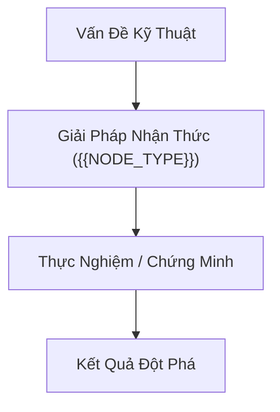

# Technical Research Paper: {{TOPIC}}

> **Chuẩn Mực Fractal Tree-to-Paper Synthesis (Lá Độc Lập — Gốc Hợp Nhất)**
> - **Nếu là Node Gốc (Root Node)**: Hoạt động như **Master Executive Whitepaper**, tổng hợp toàn cảnh tri thức của Miền và nhúng liên kết/tóm tắt từ các Node con (`[[tech_<node_type>_...md]]`).
> - **Nếu là Node Con (Leaf Node)**: Hoạt động như **Atomic Cognitive Block**, tập trung 100% chuyên sâu vào kiểu nhận thức của mình (Toán học, Mã nguồn PoC, Số liệu Benchmark, Ma trận Đánh đổi, hay Phân tích FMEA).

## Table of Contents
1. [Abstract](#1-abstract)
2. [Introduction & Context](#2-introduction--context)
3. [Methodology & Epistemic Formulation](#3-methodology--epistemic-formulation)
4. [Core Technical Evidence & Insights](#4-core-technical-evidence--insights)
5. [Evaluation, Trade-offs & Failure Modes](#5-evaluation-trade-offs--failure-modes)
6. [Architectural Synthesis & Domain Integration](#6-architectural-synthesis--domain-integration)
7. [References & IEEE Citations](#7-references--ieee-citations)

---

## 1. Abstract
[Mô tả ngắn gọn (150-250 từ) về mục tiêu, phương pháp nhận thức (Node Type: {{NODE_TYPE}}) và kết quả cốt lõi của nghiên cứu.]

## 2. Introduction & Context
[Định nghĩa bối cảnh kỹ thuật, khoảng trống tri thức cần giải quyết và vai trò của Node này trong toàn bộ Cây Tri Thức DAG.]

## 3. Methodology & Epistemic Formulation
- **Phân vai Persona**: Thực hiện bởi **{{PERSONA}}** trong Bounded Context độc lập.
- **Tiến trình nhận thức**:
  - *Nếu là `formal_proof`*: Trình bày hệ tiên đề, không gian trạng thái, định lý và chứng minh tiệm cận Big-O.
  - *Nếu là `empirical_poc`*: Trình bày kiến trúc prototype, sandbox testing và kết quả thực thi mã nguồn.
  - *Nếu là `benchmark`*: Trình bày phương pháp đo lường, phân phối P50/P95/P99 và bảng đối chuẩn định lượng.
  - *Nếu là `trade_off`*: Trình bày ma trận Pareto đa tiêu chí và không gian đánh đổi kiến trúc.
  - *Nếu là `failure_mode`*: Trình bày bảng FMEA, Severity/Occurrence/Detection và hàng rào phòng thủ.

## 4. Core Technical Evidence & Insights

### Verified Key Insights Summary

| ID | Source | Category | Credibility Tier | Key Finding | Confidence |
| :--- | :--- | :--- | :--- | :--- | :--- |
| [INS-1] | [Source A] | `academic_paper` | **Tier-1 (Peer-Reviewed / Formal Spec)** | [Phát hiện 1] | High |
| [INS-2] | [Source B] | `official_specification` | **Tier-1 (Peer-Reviewed / Formal Spec)** | [Phát hiện 2] | High |

## 5. Architectural Synthesis & Domain Integration
- **Liên kết Cây Tri Thức (DAG Links)**:
  - Phụ thuộc (depends_on): [[Node_A]]
  - Chứng minh (proves): [[Node_B]]
  - Phản biện (questions/refutes): [[Node_C]]
- **Tích hợp vào Master Whitepaper**: Tóm tắt 2-3 câu giá trị nhất để đưa vào Executive Summary của Node Gốc.

## 6. References & IEEE Citations
1. [Tác giả], "[Tiêu đề tài liệu]", [Tên hội nghị/tạp chí], vol. X, no. Y, pp. Z, [Năm].
