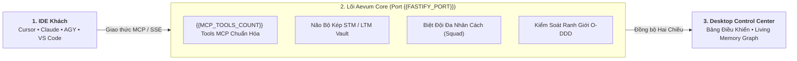

# Tổng quan về Aevum OS

**Aevum OS** là Hệ điều hành Không gian làm việc Tác nhân (Agentic OS) và **Bộ não Ngoại vi Sống (Living External Brain)** độc lập, được thiết kế chuyên biệt để đồng hành cùng các AI Coding Agent hàng đầu (Cursor, Claude Desktop, Antigravity IDE, VS Code, Windsurf).

Hệ thống giải quyết triệt để rào cản lớn nhất của kỷ nguyên lập trình cùng AI: **"Hội chứng mau quên" (Context Amnesia)**, AI tự ý sửa code ngoài ranh giới (Out-of-boundary code drift) và lãng phí hàng nghìn token vô ích mỗi phiên làm việc.

> [!NOTE]
> **Phiên bản mới nhất**: [Aevum OS {{AEVUM_VERSION}}](/changelog) — Vận hành trên lõi Fastify v5 Core Daemon (Port {{FASTIFY_PORT}}), hỗ trợ {{MCP_TOOLS_COUNT}} công cụ Model Context Protocol (MCP) chuẩn hóa. Xem toàn bộ cập nhật tại [Nhật ký Cập nhật](/changelog).

---

## Nỗi Đau Thực Tế & Cách Aevum OS Chữa Lành

| Thách thức khi dùng AI Coding truyền thống | Cách Aevum OS giải quyết triệt để |
|---|---|
| **AI mau quên (Context Amnesia)**: Sau vài lượt trao đổi, AI quên sạch quy ước kiến trúc, tái phạm các lỗi đã dặn từ trước. | **Bộ nhớ Dài hạn Nhận thức (LTM)**: Lưu trữ vĩnh viễn các quy tắc, sở thích lập trình và bài học kiến trúc vào kho tri thức độc lập. |
| **Lãng phí Token**: Nhồi nhét hàng nghìn dòng code thô vào prompt làm đầy cửa sổ ngữ cảnh và chi phí API tăng vọt. | **Nén Ngữ nghĩa (Universal Semantic Middleware)**: Trích xuất cấu trúc trọng tâm qua AST Vault, tiết kiệm tới 70% token mà vẫn giữ trọn ngữ nghĩa. |
| **Code thiếu kiểm soát (Code Drift)**: AI tự ý viết code lan man, xâm phạm các module khác và phá vỡ cấu trúc Clean Architecture. | **Kỷ luật O-DDD & Khóa Ranh Giới (Plan-First)**: Mọi thay đổi lớn bắt buộc trải qua chu trình 4 bước có kiểm định ranh giới (Boundary Guard). |
| **Một AI "ôm đồm" tất cả**: Một mô hình đơn lẻ vừa phải thiết kế kiến trúc, vừa viết giao diện, vừa rà soát bảo mật. | **Biệt Đội Đa Tác Nhân (Multi-Agent Swarm)**: Phân công chuyên môn hóa cao (An kiến trúc, Luna giao diện, Vidus kiểm toán, Zenith hạ tầng) cùng khả năng tuyển dụng không giới hạn. |

---

## Kiến trúc Tổng quan Tối giản & Trực quan

Thay vì để AI phụ thuộc hoàn toàn vào cửa sổ chat hạn hẹp của IDE, Aevum OS vận hành như một **máy chủ nhận thức độc lập**:

---

## Các Tính Năng Đột Phá Nổi Bật

1. **Chuẩn Kết Nối Model Context Protocol (MCP)**: Tương thích sẵn với Cursor, Claude Desktop, Antigravity IDE, Windsurf và Cline. Tích hợp 1-click hoặc chỉ 3 dòng cấu hình JSON là kết nối ngay.
2. **Nghi thức Bắt tay Chuẩn v2.0 (Handshake Ritual)**: Mỗi khi mở IDE, AI tự động kết nối qua Bridge, nạp đúng danh tính Persona và nén quy tắc dự án chỉ trong tích tắc.
3. **Quản trị Kế hoạch Chống Nhảy Cóc (O-DDD Plan Lifecycle)**: Lập kế hoạch rõ ràng, khóa ranh giới tệp (`activeFiles`), cập nhật tiến độ từng bước theo thời gian thực và tự động lưu trữ di sản (Cellular Archive).
4. **Tự Động Đúc Kết Kỹ Năng (Autonomous Skill System)**: Khi AI gỡ thành công một lỗi khó, giải pháp được chưng cất thành quy trình chuẩn (SOP) để cả đội ngũ cùng tái sử dụng mãi mãi.
5. **Đồ Thị Tri Thức Sống (Living Memory Graph)**: Neo giữ bài học trực tiếp vào từng hàm, class và dòng code với khả năng tự phục hồi khi code thay đổi (Self-Healing).
