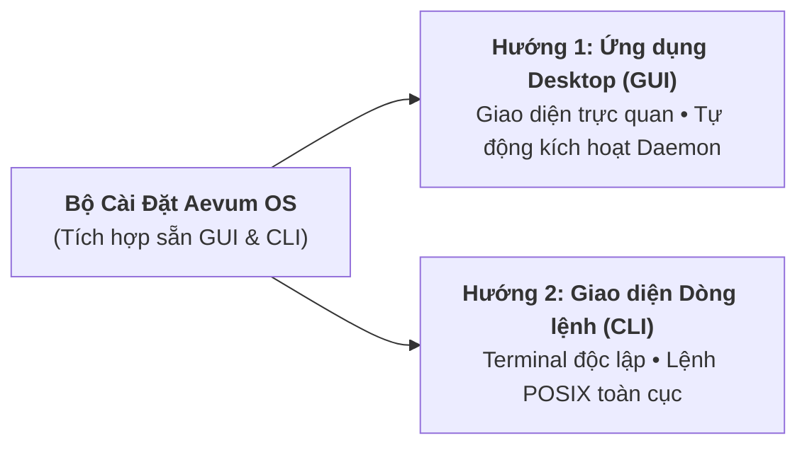

# Cài đặt & Thiết lập Nhanh (3 Phút Quickstart)

Aevum OS cung cấp bộ cài đặt máy tính để bàn (Desktop App) hoàn chỉnh cho cả Windows và macOS. Khi bạn cài đặt Desktop App, hệ sinh thái Aevum OS sẽ **tự động thiết lập sẵn toàn bộ Fastify Core Daemon và tích hợp bộ công cụ dòng lệnh (Aevum CLI) toàn cục vào biến môi trường hệ thống**.

Bạn không cần phải thiết lập môi trường rời rạc hay thực hiện các thao tác cấu hình phức tạp!

> [!NOTE]
> **Phiên bản mới nhất**: [Aevum OS {{AEVUM_VERSION}}](/changelog) — Tải trực tiếp tại [Nhật ký Cập nhật](/changelog) hoặc [GitHub Releases]({{LATEST_RELEASE_URL}}).

---

## Bước 1: Tải & Cài Đặt Gói Ứng Dụng

Chọn gói cài đặt phù hợp với hệ điều hành của bạn:

* **Windows 10 / 11 (x64)**: Tải [{{WINDOWS_INSTALLER}}](/changelog)
* **macOS (Apple Silicon M1-M4)**: Tải [{{MACOS_ARM_DMG}}](/changelog)
* **macOS (Intel Core x64)**: Tải [{{MACOS_INTEL_DMG}}](/changelog)

> [!TIP]
> **Mẹo xác thực khi mở ứng dụng lần đầu:**
> * Trên **Windows**: Nếu xuất hiện màn hình SmartScreen, bạn bấm **More info** ➔ **Run anyway** để tiếp tục.
> * Trên **macOS**: Nhấn giữ phím **Control** + click chuột phải vào app ➔ Chọn **Open** để xác nhận mở ứng dụng.

Sau khi cài đặt hoàn tất, hệ thống tự động gắn lệnh `aevum` vào Terminal/PowerShell của bạn để sẵn sàng sử dụng ở bất kỳ đâu.

---

## Bước 2: Lựa Chọn Hướng Trải Nghiệm Phù Hợp

Bạn có thể linh hoạt sử dụng Aevum OS theo một trong hai cách dưới đây:



---

### Hướng 1: Chạy Ứng Dụng Desktop (Desktop Control Center)

Lựa chọn lý tưởng cho lập trình viên muốn theo dõi kiến trúc và giao tiếp trực quan:

1. **Khởi động**: Mở ứng dụng **Aevum OS** từ màn hình Desktop (Windows) hoặc Launchpad (macOS).
2. **Cơ chế tự động**: Ngay khi ứng dụng xuất hiện, **Fastify Core Daemon** tự động kích hoạt ngầm tại cổng `{{FASTIFY_PORT}}` mà bạn không cần duy trì bất kỳ cửa sổ console nào.
3. **Các tính năng nổi bật trên giao diện**:
   * **Lean Workspace & Agent Chat**: Trò chuyện trực tiếp cùng Persona yêu thích trên giao diện 120 FPS với bộ chọn mô hình đa nhà cung cấp (Claude, Gemini, GPT) và chế độ tự hành **Hermes**.
   * **Workspace Overview**: Theo dõi chỉ số sức khỏe codebase và nhật ký nhịp sống hệ thống theo thời gian thực.
   * **Skill Tree Canvas**: Khám phá cây kỹ năng và đồ thị nghiên cứu cộng sinh (Co-Research Cockpit).
   * **Living Memory Graph**: Quan sát đồ thị tri thức sống động gắn liền theo từng tệp mã nguồn.

---

### Hướng 2: Chạy Qua Dòng Lệnh (CLI Terminal Engine)

Dành cho kỹ sư ưa chuộng giao diện terminal, kịch bản CI/CD hoặc môi trường máy chủ headless:

```bash
# 1. Khởi chạy máy chủ MCP Fastify Daemon tại cổng mặc định {{FASTIFY_PORT}}
aevum

# 2. Kiểm tra trạng thái hoạt động và các công cụ sẵn sàng
aevum status
# Output: ONLINE (Port {{FASTIFY_PORT}}, Fastify v5 Core, {{MCP_TOOLS_COUNT}} Tools Sẵn sàng)

# 3. Kiểm tra nhịp tim lắng nghe phản hồi siêu tốc (< 1ms)
aevum ping
# Output: pong (Aevum Fastify Daemon is healthy)

# 4. Mở giao diện Desktop từ Terminal bất kỳ lúc nào
aevum gui
```

---

## Bước Kế Tiếp

Sau khi Aevum OS đã chạy (qua Desktop App hoặc CLI), hãy liên kết Aevum OS vào IDE lập trình của bạn (Cursor, Claude Desktop, Antigravity, VS Code).

Chuyển sang mục tiếp theo: **[Tích hợp (Integration)](/docs/integration)**.
