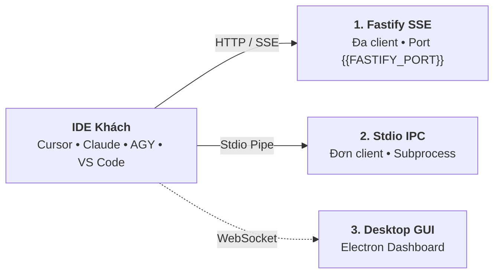

# Các Chế độ Hoạt động (Runtime Execution Modes)

Aevum OS được kiến tạo theo triết lý phi tập trung, hỗ trợ 3 chế độ hoạt động linh hoạt tùy thuộc vào môi trường và thói quen làm việc của bạn:



---

## 1. Chế độ Server-Sent Events (SSE Mode) — Khuyến nghị

Đây là chế độ mạnh mẽ và toàn diện nhất của Aevum OS. Hệ thống chạy như một máy chủ nhận thức độc lập trên nền tảng **Fastify v5**, lắng nghe trên cổng `{{FASTIFY_PORT}}`.

```bash
# Khởi động Daemon ở chế độ SSE
aevum --transport sse --port {{FASTIFY_PORT}} --workspace /path/to/project
```

### Tại sao SSE Mode là lựa chọn hàng đầu?
* **Đa Client Đồng thời**: Một Daemon duy nhất có thể phục vụ cùng lúc Cursor, Claude Desktop, Antigravity IDE và Web Dashboard mà không hề xung đột hay khóa cứng tài nguyên.
* **Tách rời Vòng đời**: Khi bạn khởi động lại IDE hoặc đổi không gian làm việc, bộ nhớ của Daemon vẫn được giữ nguyên vẹn 100%, không bị reset bộ nhớ tạm.
* **Tự động Dò Cổng (Port Fallback)**: Nếu cổng `{{FASTIFY_PORT}}` bị chiếm dụng bởi tiến trình khác, Aevum sẽ tự động thăm dò cổng kế tiếp (`3345`, `3346`...) và cập nhật tệp tín hiệu `.aevum/signal.json`.
* **API REST Bổ trợ**: Cung cấp sẵn các endpoint `/api/ping`, `/api/health`, `/api/telemetry` phục vụ giám sát và kiểm định sức khỏe thời gian thực.

---

## 2. Chế độ Standard I/O (Stdio Mode)

Trong chế độ này, IDE (như Cursor hoặc Claude Desktop) trực tiếp khởi tạo và quản lý Aevum như một tiến trình con (child process), giao tiếp thông qua hai luồng nhị phân chuẩn `stdin` và `stdout`.

```bash
# Khởi chạy chế độ Stdio
aevum --transport stdio --workspace /path/to/project
```

### Khi nào nên dùng Stdio Mode?
* **Môi trường Mạng Nghiêm ngặt**: Khi làm việc trong mạng doanh nghiệp bị hạn chế bởi tường lửa nội bộ, không cho phép mở cổng HTTP localhost.
* **Tối Ưu Tài Nguyên Tuyệt Đối**: Khi bạn muốn tiến trình Aevum tự động giải phóng bộ nhớ ngay khi đóng cửa sổ IDE trên các máy có cấu hình khiêm tốn.

---

## 3. Chế độ Giao diện Máy tính để bàn (Desktop Control Center)

Khởi chạy ứng dụng đồ họa độc lập chạy trên khung nền Electron, tích hợp trực tiếp với Fastify Core qua kênh WebSocket nhị phân:

```bash
aevum gui
```

### Các Không gian Làm việc Trực quan:
1. **Lean Workspace & Agent Chat (120 FPS)**: Giao tiếp trực tiếp với từng Persona hoặc thảo luận nhóm đa ngôi (**Thalamus Multi-Party Relay**) kèm động cơ gọi công cụ tự hành **Hermes** và bộ chọn mô hình linh hoạt (Claude, Gemini, GPT).
2. **Workspace Overview**: Quản lý cây kiến trúc Domain/Feature, theo dõi chỉ số sức khỏe codebase và xem nhật ký hoạt động thời gian thực (Circular Ring Buffer).
3. **Research Skill Tree (Dagre & React Flow)**: Khám phá đồ thị kỹ năng, cây phân nhánh nghiên cứu cộng sinh và trạng thái tinh thông của dự án.
4. **Architecture Canvas**: Bảng vẽ tương tác biểu diễn cấu trúc topo của hệ thống hỗ trợ zoom, pan và lọc theo từng Bounded Context.

---

## Bảng So sánh Chi tiết các Chế độ

| Tiêu chí so sánh | Fastify SSE Mode | Stdio IPC Mode | Desktop Control Center |
|---|---|---|---|
| **Cơ chế Giao tiếp** | HTTP Server-Sent Events | Standard In/Out Pipe | IPC + WebSocket nhị phân |
| **Số lượng IDE kết nối** | Đa Client Không Giới Hạn | Đơn Client (1:1 với IDE) | Độc lập (kèm Agent Chat) |
| **Tính bền vững Ký ức** | Vĩnh viễn (sống độc lập IDE) | Theo vòng đời cửa sổ IDE | Vĩnh viễn |
| **Tiêu tốn Tài nguyên** | Cực thấp (~45MB RAM) | Siêu thấp (~35MB RAM) | Tiêu chuẩn GUI (~120MB RAM) |
| **Khả năng Giám sát** | Log qua Terminal / REST | Log qua Debug Console | Đồ thị trực quan + Live Log Canvas |
