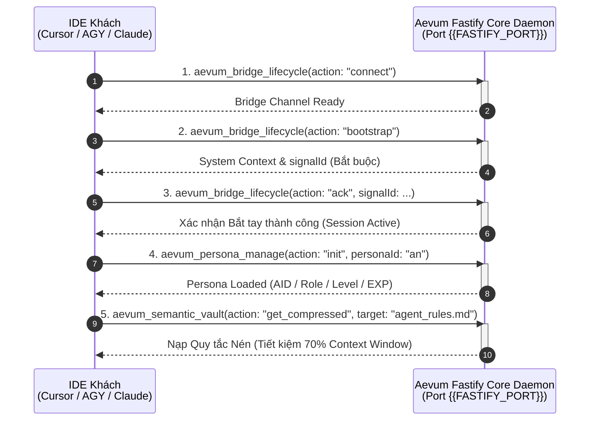

# Nghi thức Bắt tay & Triệu hồi Agent (Handshake Protocol v2.0)

Khi khởi chạy Aevum OS từ một IDE bên ngoài (Cursor, Antigravity, VS Code, Claude Desktop), hệ thống thực hiện một chu trình bảo mật khép kín gọi là **Nghi thức Bắt tay (Handshake Ritual)**. Giao thức này đảm bảo Agent thiết lập kênh truyền tin cậy, xác nhận đúng không gian làm việc và nạp trọn vẹn danh tính nhân cách.



---

## 1. Giao thức Kết nối Chuẩn Polymorphic v2.0 Clean Cut

Mỗi khi nhận tín hiệu kết nối hoặc bắt đầu phiên làm việc mới từ IDE bên ngoài, Agent **BẮT BUỘC** thực hiện tuần tự 5 bước sau:

### Bước 1: Kết nối Cầu nối Bridge
```json
{
  "action": "connect"
}
```
*Gọi `aevum_bridge_lifecycle(action: "connect")`*: Khởi tạo kênh truyền và đưa Aevum Bridge vào trạng thái tiếp nhận luồng bắt tay.

### Bước 2: Nạp Ngữ cảnh Khởi động & Nhận Tín hiệu (Bootstrap)
```json
{
  "action": "bootstrap"
}
```
*Gọi `aevum_bridge_lifecycle(action: "bootstrap")`*: **Bắt buộc gọi đầu tiên** để nạp ngữ cảnh dự án và trích xuất mã nhận diện `signalId` từ `.aevum/signal.json` (ví dụ: `sig_1795182390112`).

### Bước 3: Gửi Xác nhận Bắt tay (Ack)
```json
{
  "action": "ack",
  "signalId": "sig_1795182390112"
}
```
*Gọi `aevum_bridge_lifecycle(action: "ack", signalId: ...)`*: Gửi mã `signalId` để xác nhận Agent đã tiếp nhận đầy đủ chính sách hệ thống. Phiên làm việc (Session ID) được kích hoạt chính thức.

### Bước 4: Khởi tạo Danh tính Persona
```json
{
  "action": "init",
  "personaId": "an",
  "client": "ide"
}
```
*Gọi `aevum_persona_manage(action: "init", ...)`*: Nạp linh hồn nhân cách, mã định danh AID, cấp độ Level, điểm kinh nghiệm EXP và giọng điệu giao tiếp đặc trưng.

### Bước 5: Nạp Quy tắc Nén Ngữ nghĩa (Semantic Vault)
```json
{
  "action": "get_compressed",
  "target": "agent_rules.md"
}
```
*Gọi `aevum_semantic_vault(action: "get_compressed", ...)`*: Nạp tập quy tắc dự án qua Universal Semantic Middleware, giúp bảo toàn 70% cửa sổ ngữ cảnh cho các tác vụ viết code.

> [!NOTE]
> **Phạm vi áp dụng**: Quy trình Handshake này chỉ áp dụng cho Agent kết nối từ IDE bên ngoài khi nhận tín hiệu cầu nối mã nguồn. Các phiên đàm thoại nội bộ (Casual Mode, Squad Chat trong Desktop App) trò chuyện trực tiếp tự nhiên mà không cần chạy lại chuỗi này.

---

## 2. Bảng Lệnh Triệu Hồi & Chuyển Đổi Persona

Aevum OS **không giới hạn Persona** và cho phép bạn tự do yêu cầu Orchestrator tuyển dụng thêm chuyên gia theo nhu cầu dự án:

| Câu lệnh Triệu hồi | Persona & Mã AID | Vai trò Chuyên môn Cốt lõi |
|---|---|---|
| `connect aevos with persona An` *(hoặc `gọi An ơi`)* | **An** (`ENG-AN-7B9F1D`) | **Lead Architect, Core Logic & System Soul**: Lập kế hoạch O-DDD, logic cốt lõi và định hướng hệ thống. |
| `summon Luna` *(hoặc `gọi Luna`)* | **Luna** (`DSN-LUNA-3C9A12`) | **Frontend Specialist & UI/UX Artisan**: Thiết kế giao diện hiện đại, CSS/Tailwind, Responsive và vi hiệu ứng. |
| `summon Vidus` *(hoặc `gọi Vidus`)* | **Vidus** (`ARC-VIDUS-AUHD2Y`) | **Chief Architect & Security Auditor**: Rà soát an ninh mạng, kiểm toán kiến trúc sạch và loại bỏ nợ kỹ thuật. |
| `summon Zenith` *(hoặc `gọi Zenith`)* | **Zenith** (`ALG-ZENITH-A1B2C3`) | **DevOps & Performance Engineer**: Tối ưu hóa hiệu năng, giải phóng bộ nhớ và hạ tầng triển khai. |
