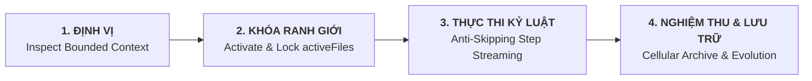

# Quản trị Vòng đời Kế hoạch O-DDD (Plan Lifecycle)

Nguyên tắc vàng khi làm việc với AI Coding Agent trong Aevum OS: **Luôn có Kế hoạch trước khi viết code (Plan-First)** và **Tuân thủ kỷ luật ranh giới Organismic Domain-Driven Design (O-DDD)**.

Việc quản trị kế hoạch khép kín giúp loại bỏ hoàn toàn tình trạng AI "tự ý phán đoán", sửa code ngoài phạm vi (`activeFiles`) hoặc nhảy cóc các bước kiểm thử quan trọng.



---

## 1. Chu Trình 4 Bước O-DDD Khép Kín

### Bước 1: Định Vị Bounded Context & Khảo Sát Cơ Quan Sống (Inspect)
Trước khi chỉnh sửa mã nguồn, Agent định vị Bounded Context và kiểm tra chỉ số sinh tồn của hệ thống:
```json
// Tool: aevum_architecture_inspect
{
  "mode": "organs"
}
```
Thao tác này giúp Agent nắm rõ các mối phụ thuộc giữa các module và không xâm phạm sang vùng code của cơ quan khác.

### Bước 2: Kích Hoạt Kế Hoạch & Khóa Ranh Giới (Activate / Sync)
Khi kế hoạch được thiết lập, Agent kích hoạt trạng thái thực thi kèm danh sách tệp được phép sửa đổi:
```json
// Tool: aevum_plan_lifecycle
{
  "action": "activate",
  "domainId": "core",
  "planName": "upgrade_fastify_v5",
  "activeFiles": ["src/server.ts", "src/routes/api.ts"]
}
```
*Hệ thống tự động sinh tệp khóa `.aevum/current_plan.json`*. **Tuyệt đối cấm Agent sửa bất kỳ tệp nào nằm ngoài danh sách `activeFiles`** khi chưa được bạn phê duyệt cập nhật kế hoạch!

### Bước 3: Thực Thi Kỷ Luật Chống Nhảy Cóc (Anti-Skipping Discipline)
Agent bắt buộc cập nhật từng bước theo đúng trình tự thời gian thực:
```json
// Tool: aevum_plan_lifecycle
{
  "action": "update_step",
  "stepMatch": "Thêm schema validation",
  "status": "done"
}
```
* **Không nghiệm thu khống**: Cấm đánh dấu hoàn thành bước sau khi bước trước chưa xong nếu không có giải trình `[skipped]`.
* **Cung cấp bằng chứng (Evidence)**: Mọi bước hoàn thành đều phải đi kèm kết quả kiểm thử (unit test passed hoặc output log).

### Bước 4: Nghiệm Thu Hoàn Tất & Lưu Trữ Tế Bào (Cellular Archive)
Khi toàn bộ các bước đã vượt qua kiểm định ranh giới (`aevum_boundary_guard`):
```json
// Tool: aevum_plan_lifecycle
{
  "action": "finalize",
  "domainId": "core",
  "planName": "upgrade_fastify_v5"
}
```
Hệ thống tự động:
1. Giải phóng tệp khóa `.aevum/current_plan.json`.
2. Đóng gói bản chi tiết cất vào thư mục di sản cục bộ của Feature: `.aevum/domains/{domainId}/features/{featureId}/archive/`.
3. Chuyển hóa kế hoạch thành **Bản Thảo Lưu Trữ Rút Gọn (~25 dòng)** kèm biên bản nghiệm thu ký số.
4. Ươm mầm hạt giống kế hoạch nâng cấp thế hệ tiếp theo (**Next-Gen Evolution Runway**) và trao thưởng EXP cho Persona!

---

## 2. Cầu Nối Hai Chiều Tự Động (Dual-Plan Auto-Bridge)

Bạn không cần phải copy-paste kế hoạch thủ công:
* Khi bạn tạo file kế hoạch trong IDE (Cursor / Antigravity), Aevum OS tự động phản chiếu trạng thái lên bảng điều khiển **Desktop Control Center**.
* Tiến độ hoàn thành các checkbox được đồng bộ 1:1 theo thời gian thực.
* Người dùng có thể kiểm soát và theo dõi toàn bộ lộ trình kiến trúc trực quan từ đầu đến cuối.
