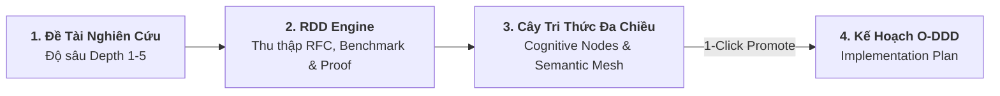

# Không gian Nghiên cứu Tự trị (Deep Research Engine)

Khi đối mặt với một bài toán công nghệ mới (ví dụ: *Nên chọn kiến trúc phân tán nào cho Microservices? Cách thiết lập Distributed Cache chịu tải 100k CCU?*), lập trình viên thường mất hàng giờ đọc tài liệu và so sánh các bài viết trên mạng.

**Deep Research Engine** trong Aevum OS là trợ lý nghiên cứu tự trị theo chuẩn **Research-Driven Design (RDD)**: cho phép AI tự động thu thập tài liệu khoa học, xây dựng cây tri thức đa chiều và biến kết quả nghiên cứu thành **Kế hoạch Kỹ thuật thực thi chỉ với 1 thao tác**.

---

## 1. Khai Thác Đa Hình Nút Nhận Thức (Cognitive Node Types)

Thay vì những bản tóm tắt đơn điệu, cây nghiên cứu của Aevum OS phân rã bài toán thành các nút nhận thức chuyên sâu:

* **`formal_proof`**: Chứng minh toán học, công thức và đánh giá độ phức tạp thuật toán (Big-O).
* **`empirical_poc`**: Bằng chứng thực nghiệm (Proof of Concept) được kiểm chứng trực tiếp trong sandbox.
* **`benchmark`**: Đo kiểm số liệu hiệu năng thực tế (Latency, Throughput, Memory footprint).
* **`trade_off`**: Phân tích đánh đổi giữa các phương án kiến trúc.
* **`failure_mode`**: Dự báo rủi ro lỗi (FMEA) và các kịch bản suy thoái hệ thống.
* **`debate`**: Tranh luận đa chiều giữa các Persona (An, Vidus, Zenith) để tìm ra chân lý tối ưu.

---

## 2. Quy Chuẩn Tổng Hợp Fractal (Lá Độc Lập — Gốc Hợp Nhất)

* **Lá Độc Lập (Atomic Papers)**: Mỗi nút nghiên cứu con sở hữu một bài báo chuyên khảo độc lập (`.aevum/research/tech_<type>_<topic>.md`), do Persona phụ trách chuyên môn hoàn thiện.
* **Gốc Hợp Nhất (Living Master Whitepaper)**: Nút gốc (Root Node) đóng vai trò bản tổng luận toàn miền, tổng hợp toàn bộ các phân nhánh qua liên kết sâu (`[[tech_...md]]`), sẵn sàng để xuất bản thành báo cáo kỹ thuật tiêu chuẩn IEEE/ACM hoàn chỉnh.

---

## 3. Trực Quan Hóa Cây Tri Thức (Skill Tree Canvas)

Trên ứng dụng **Desktop Control Center**:
* Toàn bộ tiến trình nghiên cứu được hiển thị thành một **Chòm sao Kỹ năng tương tác**.
* Các liên kết ngữ nghĩa (`proves`, `depends_on`, `compares_with`, `refutes`) biểu diễn mối quan hệ logic chặt chẽ giữa các luận điểm.
* Trạng thái nghiên cứu phản ánh trực tiếp theo thời gian thực (Đang khám phá ➔ Tinh thông).

---

## 4. Tính Năng Đột Phá: Thăng Cấp Thành Kế Hoạch (1-Click Promote to Plan)

Điểm khác biệt lớn nhất giữa Aevum OS và việc tra cứu thông thường: **Tri thức nghiên cứu kết nối trực tiếp với luồng viết code**.

Sau khi báo cáo nghiên cứu hoàn tất, bạn chỉ cần nhắn:

> *"Báo cáo rất chi tiết! Hãy biến đề xuất này thành Kế hoạch thực thi trong dự án nhé."*

Hệ thống sẽ tự động kích hoạt tính năng **Promote to Plan**:
* Chuyển hóa toàn bộ khuyến nghị kiến trúc thành danh sách đầu việc cụ thể trong kế hoạch O-DDD.
* Khóa ranh giới tệp (`activeFiles`) và phân công cho Persona trong Biệt đội để bắt tay vào thực thi ngay lập tức!
